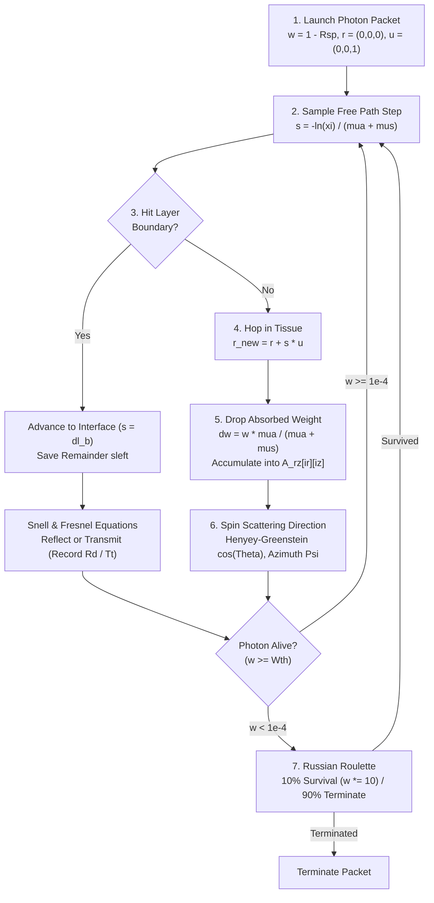

# Radiative Transfer Physics & Parallel Architecture

This document details the theoretical physics foundation (the **Radiative Transport Equation** and **Photodynamic Therapy dosimetry**) and the high-performance computing architecture (**OpenMP** and **NVIDIA CUDA**) implemented in `mcml-gpu`, based on the research by **N. López-Marín, F. Corrales-Machín et al.** (*Revista Cubana de Física*, 2016), **F. Corrales Machín** (*B.Sc. Thesis, University of Havana*, 2015), and **Wang, Jacques, & Zheng** (*Comput. Methods Programs Biomed.*, 1995).

---

## 1. Theoretical Physics Foundation

### 1.1 The Radiative Transport Equation (RTE)
Light propagation in heterogeneous, turbid biological media is governed by the integro-differential **Radiative Transport Equation (RTE)**:

$$\frac{1}{c}\frac{\partial I_\nu(\vec{r},\hat{s},t)}{\partial t} + \hat{s}\cdot\nabla I_\nu(\vec{r},\hat{s},t) = -(\mu_a + \mu_s)I_\nu(\vec{r},\hat{s},t) + \mu_s \int_{4\pi} P(\hat{s},\hat{s}')I_\nu(\vec{r},\hat{s}',t)\,d\Omega' + j_\nu(\vec{r},\hat{s},t)$$

where:
- $I_\nu(\vec{r}, \hat{s}, t)$ is the spectral radiance (specific intensity) at position $\vec{r}$ traveling in unit direction $\hat{s}$ $[\text{W}\cdot\text{cm}^{-2}\cdot\text{sr}^{-1}\cdot\text{Hz}^{-1}]$,
- $c = c_0 / n$ is the speed of light in the tissue layer of refractive index $n$,
- $\mu_a$ and $\mu_s$ are the macroscopic linear absorption and scattering coefficients $[\text{cm}^{-1}]$, with total interaction coefficient $\mu_t = \mu_a + \mu_s$,
- $P(\hat{s}, \hat{s}')$ is the scattering phase function normalized over $4\pi$ steradians,
- $j_\nu(\vec{r}, \hat{s}, t)$ is the local source emission term.

Integrating $I_\nu$ over all solid angles yields the **fluence rate** $\psi(\vec{r}, t) = \int_{4\pi} I_\nu(\vec{r}, \hat{s}, t)\,d\Omega\,d\nu$ $[\text{W}\cdot\text{cm}^{-2}]$, which directly determines the local therapeutic light dose in **Photodynamic Therapy (PDT)** for oncology (e.g., Basal Cell Carcinoma irradiated at $\lambda = 630\text{ nm}$).

### 1.2 Why Monte Carlo Radiative Transfer (MCRT)?
Analytical solutions to the RTE exist only for trivial geometries. As established in Chapter 1 of Corrales-Machín (2015), standard approximations break down in clinical tissue optics:

| Physical Capability | Beer-Lambert Law ($I_0 e^{-\mu_a z}$) | Diffusion Approximation | Monte Carlo Radiative Transfer (`mcml-gpu`) |
| :--- | :---: | :---: | :---: |
| **Absorption ($\mu_a$)** | Yes | Yes | **Yes (Exact)** |
| **Isotropic Scattering ($g = 0$)** | No | Yes | **Yes (Exact)** |
| **Anisotropic Forward Scattering ($g \neq 0$)** | No | No | **Yes ($g \in [-1, 1]$, tissue $g \approx 0.8\text{–}0.95$)** |
| **Unrestricted $\mu_s / \mu_a$ Ratio** | No ($\mu_s = 0$ required) | No ($\mu_s \gg \mu_a$ required) | **Yes (Arbitrary $\mu_a, \mu_s$)** |
| **Refractive Mismatched Boundaries & Near-Source Accuracy** | No | No (Fails near $z \to 0$) | **Yes (Exact Fresnel/Snell interfaces)** |

While deterministic quadrature methods in $m$ dimensions suffer from the curse of dimensionality with error $O(N^{-1/m})$, Monte Carlo importance sampling converges as **$O(N^{-1/2})$** regardless of phase-space dimensionality.

### 1.3 Subsurface Retro-Dispersion Peak & Cylindrical Normalization
In forward-scattering biological tissue (such as Basal Cell Carcinoma at $\lambda = 630\text{ nm}$: $n = 1.37$, $\mu_a = 1.7\text{ cm}^{-1}$, $\mu_s = 125\text{ cm}^{-1}$, $g = 0.8$), backscattered photons near the incident surface cause the absorbed energy density $A(r, z)$ to **increase** immediately below the surface, reaching a subsurface maximum around $z \approx 0.02\text{ cm}$ before decaying exponentially with depth (demonstrated in Figures 4–5 of López-Marín, Corrales-Machín et al., 2016).

Using cylindrical symmetry around the beam axis, the 2D absorption array `A_rz[ir][iz]` accumulates absorbed photon weights inside concentric annular rings of radial thickness $\Delta r$, depth $\Delta z$, and inner radius $r = i_r \Delta r$. The differential volume of ring $i_r$ is:

$$\Delta V(i_r) = \pi \Delta r (2r + \Delta r)\Delta z = 2\pi \left(i_r + \frac{1}{2}\right)(\Delta r)^2 \Delta z$$

Dividing the accumulated weight by $N \cdot \Delta V(i_r)$ yields the absorbed photon probability density $A(r, z)$ $[\text{cm}^{-3}]$, and dividing by $\mu_a$ yields the fluence distribution $F(r, z) = A(r, z) / \mu_a$ $[\text{cm}^{-2}]$.

---

## 2. Stochastic Hop-Drop-Spin Transport Cycle

1. **Step Size Sampling (`StepSizeInTissue`)**:
   $$s = \frac{-\ln(\xi)}{\mu_a + \mu_s}, \quad \xi \in (0, 1]$$
2. **Weight Attenuation (`Drop`)**:
   $$\Delta w = w \frac{\mu_a}{\mu_a + \mu_s}, \quad w \leftarrow w - \Delta w$$
3. **Henyey-Greenstein Phase Function (`SpinTheta`, `Spin`)**:
   $$P(\cos\Theta) = \frac{1}{2}\frac{1 - g^2}{(1 + g^2 - 2g\cos\Theta)^{3/2}} \implies \cos\Theta = \frac{1}{2g}\left[1 + g^2 - \left(\frac{1 - g^2}{1 - g + 2g\xi}\right)^2\right] \quad (g \neq 0)$$
   where $g = \langle\cos\Theta\rangle \in [-1, 1]$ is the anisotropy parameter and azimuthal angle $\Phi = 2\pi\xi_2 \in [0, 2\pi)$.

---

## 3. HPC Parallel Architecture (Evolution from `S02`/`A01`–`A09` to `mcml-gpu`)

### 3.1 Algorithmic Evolution
In López-Marín, Corrales-Machín et al. (2016) and Corrales-Machín (2015), five implementations were studied for monolayer tumoral transport across $N \in [10^6, 10^{10}]$ photon packets:
- **`S02` (Serial CPU)**: Single-threaded ANSI C reference implementation.
- **`A01` (Host-Driven GPU Kernel)**: Launches a GPU kernel where each thread traces 1 photon packet per launch while the CPU iterates over batches.
- **`A02` (In-Kernel Persistent Loop)**: Eliminates host-launch overhead by assigning multiple photon packets per GPU thread inside a single kernel call.
- **`A06` (Fast-Math ALU Intrinsics)**: Combines `A02` with hardware fast-math transcendental intrinsics (`--use_fast_math`).
- **`A07` / `A09` (Multi-GPU + Pinned Memory)**: Distributes `A06` across dual GPUs with page-locked host memory.

**`mcml-gpu` (v1.4)** fulfills the three future-work recommendations formulated in Chapter 5 of Corrales-Machín (2015) and extends them with Turing-generation SIMT optimizations:
1. **Multi-Layer Tissue Generalization**: Supports arbitrary $L$-layer tissue stacks with exact Fresnel reflection/refraction and precomputed critical angles (`cos_crit0`, `cos_crit1`).
2. **Modernized PRNG Architecture**: Replaces heavy `cuRAND XORWOW` state arrays on the GPU with register-resident 64-bit `SplitMix64` + `xorshift64*` per thread, and thread-private `ran3` streams (`#pragma omp threadprivate`) on the CPU.
3. **Dual-Mode Shared-Memory Histogram Privatization (`src/mcml/mcmlgpu.cu`)**:
   - **`SHARED_MODE = 1` (Full-Grid Caching)**: For compact grids ($\le 4,096$ bins, 32 KB), the entire `A_rz`, `Rd_ra`, and `Tt_ra` arrays reside in on-chip `__shared__` memory per thread block.
   - **`SHARED_MODE = 2` (`64 × 64` Hot-Spot Sub-Grid Privatization)**: For large clinical grids (such as the $400 \times 800$ Basal Cell Carcinoma grid), each block privatizes the high-contention $64 \times 64$ subsurface pencil-beam entry core ($i_r < 64, i_z < 64$) in 32 KB of `__shared__` SRAM, flushing to global VRAM once at kernel exit.
4. **Persistent In-Loop Photon Respawning (Dynamic Batch Work-Queue)**: Instead of stalling 31 warp lanes inside a nested `while (!p.dead)` loop until the longest-lived photon terminates, any lane whose photon dies immediately claims a new photon from an atomic batch queue (`WORK_BATCH_SIZE = 64`) on the next step iteration, keeping all 32 warp lanes continuously active.

### 3.2 Scaling Law & Statistical Equivalence Metrics
- **Linear Execution-Time Scaling Law**:
  $$t(N) = \frac{N^m}{C}$$
  where $m \approx 1.000$ confirms absence of algorithmic saturation and $C$ $[\text{photons}\cdot\text{s}^{-1}]$ measures steady-state hardware throughput.
- **Matrix Relative Discrepancy ($E_{ij}$)**:
  $$E_{ij} = \frac{|A_{1}(r_i, z_j) - A_{2}(r_i, z_j)|}{A_{1}(r_i, z_j)} \times 100\%$$
  Used to verify that parallel CPU/GPU kernels produce statistically indistinguishable absorption distributions from the serial baseline.

---

## 4. Module & Build Target Reference

| File | Target | Responsibility |
| :--- | :--- | :--- |
| [`include/mcml.h`](../include/mcml.h) | Header | Core data structures (`PhotonStruct`, `LayerStruct`, `InputStruct`, `OutStruct`) and C/CUDA API |
| [`src/mcml/mcmlmain.c`](../src/mcml/mcmlmain.c) | `mcml` | CLI parser (`--gpu`, `--cpu`, `--threads`), OpenMP dynamic loop, and wall-clock timing |
| [`src/mcml/mcmlgpu.cu`](../src/mcml/mcmlgpu.cu) | `mcml_core` | NVIDIA CUDA kernel (`__constant__` layers, `xorshift64*` PRNG, `__shared__` privatization) |
| [`src/mcml/mcmlgo.c`](../src/mcml/mcmlgo.c) | `mcml_core` | CPU Hop-Drop-Spin physics engine, Fresnel optics, and OpenMP `threadprivate` RNG |
| [`src/mcml/mcmlio.c`](../src/mcml/mcmlio.c) | `mcml_core` | `.mci` parser, cylindrical ring volume normalization (`ScaleA`, `ScaleRdTt`), and `.mco` writer |
| [`src/mcml/mcmlnr.c`](../src/mcml/mcmlnr.c) | `mcml_core` | Zero-initialized 1D vector and 2D matrix dynamic memory allocators |
| [`tests/test_physics.c`](../tests/test_physics.c) | `test_physics` | Automated CTest suite verifying PRNG, Fresnel TIR, Henyey-Greenstein moments, and energy conservation |
